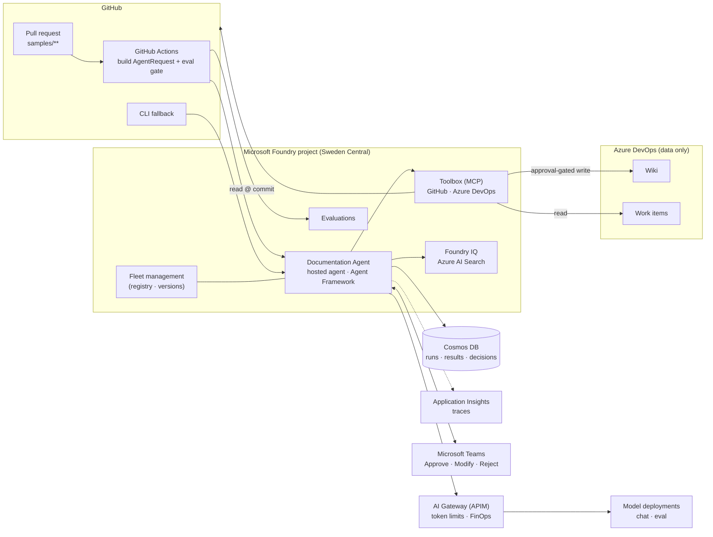
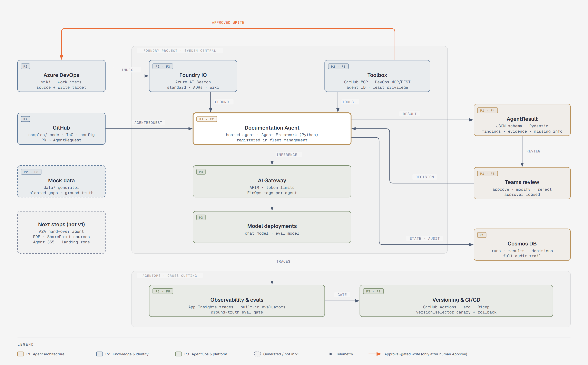

# foundry-agentic-pattern

Reference pattern for building **governed, versioned, evaluated agents on Microsoft Foundry**, with a minimal **Documentation Agent** as the first implementation.

> **Status (recorded execution through 2026-10-19; telemetry checked 2026-10-20):** the hosted Documentation Agent performs read-only assessments using Foundry IQ, GitHub and Azure DevOps. Serving is pinned to version **6**; task-aware candidate **7** is deployed but not promoted. P3 verified one version-6 result, its reviewed-source provenance and correlated native model/tool spans. Full hosted evaluation, live approved wiki writes, Teams delivery and timed rollback remain unverified. See the [deployment record](docs/setup.md#recorded-hosted-serving-and-candidate-state-2026-10-19), [hosted telemetry proof](docs/setup.md#hosted-native-trace-evidence-2026-10-20) and [roadmap](#status--roadmap).
>
> **Scope:** this is a workshop that **shows Microsoft Foundry's tools and platform**. We keep the flow simple and use platform-native features first; production hardening is covered as [next steps](docs/next-steps.md#9-production-hardening-out-of-mvp-scope) ([ADR 0022](docs/adr/0022-mvp-scope-platform-first.md)).

The [prompt-agent gap-analysis demo](docs/workshop/gap-analysis-guide.md) is
historical/reference material. The main runtime is the
[hosted application](src/agents/documentation-agent/README.md), with its own
identity and a versioned read-only toolbox. The shared ADO gateway now accepts
the hosted agent; the prompt agent's ADO access no longer works.

P3's [CLI](docs/workshop/cli-trigger-guide.md) and single manual
[release workflow](docs/workshop/evaluation-release-guide.md) now target that
**hosted assessment runtime by default**. The prompt path is explicitly secondary.
Hosted CLI smoke and full release certification are different.
Merged [PR #87](https://github.com/wdhm/foundry-agentic-pattern/pull/87) implements the
five-case evaluation transport/scorer integration offline using P1's separately
opted-in source-isolation/execution interface; it is not deployed.
Live acceptance still requires reviewed isolated configuration,
an approved evaluator and thresholds, matching candidate-version evidence and
separate execution approval. No live-evaluation claim follows from offline tests.

P3's [40-minute presenter guide](docs/workshop/p3-presenter-guide.md) links the
prepared evidence slides and AI Gateway explanatory fallback. P2's
[presenter guide](docs/workshop/p2-presenter-guide.md) has the knowledge,
toolbox and identity run order with recorded fallbacks. Shared-deck
assembly, presenter review, rehearsal and backup recording remain outstanding.

The optional [AI gateway integration](docs/ai-gateway.md) adds reviewable APIM
model/read-toolbox routes and independent runtime opt-ins. **Direct mode remains
the default; no live routing, deployment or Teams/approval behavior is changed.**
The hosted assessment CLI can separately opt its named-agent Responses request
into APIM; session/version checks stay direct. Teams Activity, pipeline push
transport and approved writes remain direct.
The user-approved first deployment is **public HTTPS, model routing only**;
the independent Developer bootstrap and model-only configuration do not enable
tool/agent routes or application traffic automatically.

---

## What and why

Most organisations don't need *one* agent. They need a **repeatable way to build many**: the same contract, identity model, approval flow, audit trail, evaluation gate and release process every time. This repo has two parts:

1. **Agentic Pattern v1.** The foundation any future agent plugs into: agent contract, registry, tool/API pattern, knowledge/RAG, identity/RBAC, human approval, tracing/audit, evaluation, CI/CD, versioning and rollback.
2. **Documentation Agent v1.** One deliberately small reference agent that exercises the whole pattern end to end. When an implementation change is made, the agent compares the code, IaC and configuration against the existing documentation and the organisation's documentation standard. It proposes evidence-backed updates, and a human approves them before anything is written.

The repo **is the product**. It is delivered through a half-day, demo-driven workshop ([agenda](docs/workshop/agenda.md)). Attendees fork it privately, plug in their own sources and documentation standard, and follow the manual [setup runbook](docs/setup.md). Full `azd up` provisioning is deferred/optional, not currently available.

### The Documentation Agent story

This is the target end-to-end story, not a completed acceptance claim. The
current supported live path is a manually invoked, read-only assessment;
automatic PR execution and Teams-approved writes are not implemented end to end.

1. A pull request changes the sample integration (`samples/**`).
2. GitHub Actions builds an `AgentRequest` and calls the hosted agent. A CLI is available as a manual fallback.
3. The agent reads **controlled sources**: code/IaC/config at the exact commit, the current wiki, work items/requirements, ADRs and the documentation standard.
4. It runs a **gap analysis** and returns an `AgentResult`: documentation status, findings (category, severity, description), proposed changes, missing information, source references/evidence, confidence, and whether human review is required.
5. A human reviews the result in **Microsoft Teams**:
   - **Approve**: the wiki is updated.
   - **Modify**: the feedback goes back to the agent.
   - **Reject**: nothing changes.
6. Every run is logged with the agent, model, prompt, policy and contract version.

> **Hard rule:** if a fact cannot be supported by a source, the agent reports *"Information missing"*. It never fabricates.

## Architecture overview

The diagram shows the broader target architecture. APIM, an evaluator deployment,
Cosmos DB, automatic PR triggers and Teams writes are not deployed capabilities
of the approved MVP; use the status table and setup record for delivered scope.



For more detail, see [docs/architecture.md](docs/architecture.md). The design rationale is in [docs/adr/](docs/adr/README.md) and the known risks are in [docs/risks.md](docs/risks.md).

The workshop reference architecture is also available as a diagram ([HTML](docs/diagrams/reference-architecture.html) · [PNG](docs/diagrams/reference-architecture.png)):



## Feature map

Features are grouped into three swimlanes, each with one owner: **P1** Agent architecture (John, [@johnsward](https://github.com/johnsward)), **P2** Knowledge & identity (Rickard, [@wdhm](https://github.com/wdhm)), **P3** AgentOps & platform (Louise, [@llandinl](https://github.com/llandinl)). The **F1–F8** tags match the diagrams. Items marked *slides* are covered as next steps only. For the full table with issues, see [docs/workshop/feature-map.md](docs/workshop/feature-map.md), and for the swimlane diagram see [HTML](docs/diagrams/feature-swimlanes.html) · [PNG](docs/diagrams/feature-swimlanes.png).

| Lane | F | Capability | MVP delivery / remaining work | ADR |
|---|---|---|---|---|
| P1 | **F2** | **Hosted agent** | Foundry hosted agent (container) on Microsoft Agent Framework (Python) | [0009](docs/adr/0009-hosted-agent-runtime.md) |
| P1 | **F4** | **Output contract** | Pydantic `AgentRequest` / `AgentResult` are the single source of truth, and JSON Schema is generated from them. The agent is trigger-agnostic. | [0010](docs/adr/0010-python-and-pydantic-contracts.md), [0006](docs/adr/0006-sources-and-trigger.md) |
| P1 | **F5** | **Human-in-the-loop** | Selected-proposal approval runtime and local integration tests exist; live wiki integration and Teams delivery remain open. Assessment stays read-only. | [0008](docs/adr/0008-human-in-the-loop-approval.md) |
| P1 | – | **State & audit** | Use native conversations/traces and wiki history for MVP; dedicated Cosmos DB persistence is deferred. | [0016](docs/adr/0016-state-and-audit-cosmos-db.md), [0022](docs/adr/0022-mvp-scope-platform-first.md) |
| P1 | – | **Architecture & registry** | Foundry fleet management, with no custom registry | [0015](docs/adr/0015-registry-foundry-fleet-management.md) |
| P2 | **F3** | **Foundry IQ** | Azure AI Search knowledge base for stable sources, called by the agent as an MCP tool: the documentation standard in the MVP ([guide](docs/workshop/foundry-iq-guide.md)), ADRs and wiki discovery later | [0011](docs/adr/0011-knowledge-foundry-iq-and-toolbox.md) |
| P2 | **F1** | **Toolbox** | MCP / REST tools for GitHub and Azure DevOps (wiki, work items, Azure Repos), for versioned/volatile data | [0011](docs/adr/0011-knowledge-foundry-iq-and-toolbox.md) |
| P2 | – | **Identities & resource org** | Entra Agent ID with least privilege per source. The approver is recorded. | [0012](docs/adr/0012-agent-identity-and-rbac.md) |
| P2 | **F8** | **Mock data** | Fictional sample integration, wiki, work items, ADRs and doc standard, with planted gaps and ground truth | [0005](docs/adr/0005-generic-repo-with-fictional-data.md) |
| P3 | – | **AI Gateway / FinOps** | [Explanatory slides](docs/workshop/slides/ai-gateway.md) prepared as the accepted fallback. No live limit/cost proof. Full APIM attribution is deferred. | [0014](docs/adr/0014-infrastructure-scope.md), [0022](docs/adr/0022-mvp-scope-platform-first.md) |
| P3 | – | **Model deployments** | Existing chat and IQ embedding deployments documented; evaluator selection/deployment, chat upgrade-policy pinning and quota review remain open. | [0014](docs/adr/0014-infrastructure-scope.md) |
| P3 | **F6** | **Evals & observability** | Five pinned cases and native monitoring exist. Prompt and hosted model/tool tracing are proven; the built-in hosted evaluation gate remains open. | [0013](docs/adr/0013-evaluation-gate-in-ci.md), [0022](docs/adr/0022-mvp-scope-platform-first.md) |
| P3 | **F7** | **Versioning & CI/CD** | Manual-only hosted workflow, release safeguards and offline evaluation integration are merged; live acceptance remains outstanding. Serving pin is recorded; promotion/rollback are manual and unverified end to end. No canary support claimed. | [0003](docs/adr/0003-github-for-code-and-cicd.md), [0013](docs/adr/0013-evaluation-gate-in-ci.md) |
| *slides* | – | **Beyond v1** | A2A hand-over (P1). Agent 365, Work IQ and PDF/SharePoint (P2). Landing zones and deploy strategy (P3). | [next-steps](docs/next-steps.md) |

## Repository layout

```text
.
├── infra/                          # Manual setup scripts; full azd/Bicep provisioning deferred
├── src/
│   ├── contracts/                  # Pydantic AgentRequest / AgentResult (+ generated JSON Schema)
│   ├── agents/
│   │   └── documentation-agent/    # Foundry hosted agent (Microsoft Agent Framework)
│   └── tools/                      # Toolbox / MCP tool definitions and helpers
├── samples/
│   └── sample-integration/         # Fictional integration: code, IaC, config (the agent's "subject")
├── data/                           # Hand-made fictional sources, standard and planted gaps
├── evals/                          # Ground-truth eval sets, metrics and CI gate
├── .github/
│   └── workflows/                  # CI/CD (added in M1+)
└── docs/
    ├── architecture.md
    ├── setup.md                    # Manual Azure setup runbook (ADR 0020)
    ├── risks.md
    ├── next-steps.md
    ├── adr/                        # Architecture Decision Records
    ├── diagrams/                   # Reference architecture + feature swimlanes (HTML + PNG)
    └── workshop/                   # Workshop agenda, feature map and material
```

## Status & roadmap

| Milestone | Goal | Status |
|---|---|---|
| **M0 · Spikes** | Close the open risks R1–R4 ([risks](docs/risks.md)). R3 (identity) is done. | 🟡 In progress |
| **M1 · MVP slice** | One simple happy path on the manually set-up environment ([ADR 0020](docs/adr/0020-manual-setup-first.md), [ADR 0022](docs/adr/0022-mvp-scope-platform-first.md)): Foundry agent + Azure DevOps tools + approval + structured result + Foundry IQ + GitHub source + tracing, triggered from a CLI | 🟡 In progress |
| **M2 · Showcase increments** | Hosted read-only assessment deployed; Teams, hosted eval gate, timed rollback and gateway demo/slides disposition remain open | 🟡 Partly delivered |
| **M3 · End-to-end demo** | PR → result → Teams approval → wiki updated. The eval gate blocks a bad version and a rollback is shown. | ⚪ Planned |
| **M4 · Workshop packaging** | P3 guides and four next-step slides exist; common deck review, current demo checklist, joint dry run and backup recording remain | 🟡 In progress |

Progress is tracked in [GitHub milestones](https://github.com/wdhm/foundry-agentic-pattern/milestones) and [issues](https://github.com/wdhm/foundry-agentic-pattern/issues).

## Fork & adapt

The pattern is designed to be forked privately and adapted. Typical changes:

1. **Documentation standard.** Replace the standard file in `data/` with your own. It also controls the output language.
2. **Sources.** Point the Toolbox connections at your own GitHub repos and Azure DevOps project, or at other sources through MCP.
3. **Subject.** Replace `samples/sample-integration/` with a real integration, or point the trigger at your own repos.
4. **Ground truth.** Add your own planted gaps and expected findings in `evals/` so that the gate reflects your quality bar.
5. **Identity.** Grant the agent identity least-privilege access to your sources ([ADR 0012](docs/adr/0012-agent-identity-and-rbac.md)).
6. **Deploy.** Follow the manual [setup runbook](docs/setup.md) with reviewed resource, identity and cost approvals. Full `azd up` provisioning is future optional work, not a verified fork-and-run path.

To add a *new* agent, reuse the contract, identity, approval, audit, eval and CI/CD building blocks, and implement only the agent-specific prompt, tools and ground truth.

## Contributing

See [CONTRIBUTING.md](CONTRIBUTING.md). Significant design changes require an ADR.

## Disclaimer

This is a **sample / reference implementation** provided for learning and demonstration purposes. It is **not a supported product** and is **not production-ready as-is**. Review security, compliance, cost and operational requirements before using any part of it in your own environment. All sample data and the sample integration are fictional.

## License

[MIT](LICENSE)
