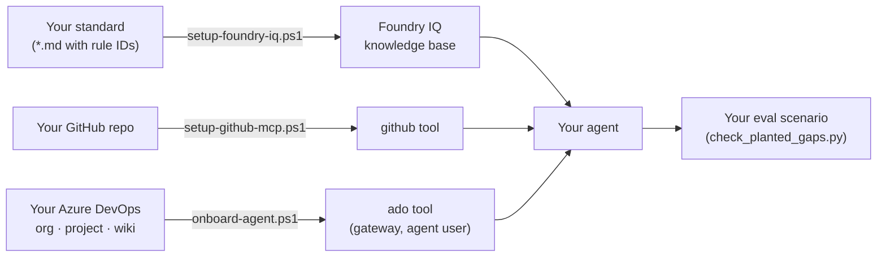

# How-to: plug in your own sources and documentation standard

The Documentation Agent is generic. The demo data (Order Sync, `integration-team`, this GitHub repo) is just configuration. This guide shows what to change to point the agent at **your** code, wiki and standard. Each step re-uses an existing, idempotent script.



| You want to change | Run | Key parameters |
|---|---|---|
| Documentation standard, output language | [`setup-foundry-iq.ps1`](../../infra/scripts/setup-foundry-iq.ps1) | `-ContentPath`, `-SourceUrlBase`, `-AgentName` |
| Code repository | [`setup-github-mcp.ps1`](../../infra/scripts/setup-github-mcp.ps1) | `-Repository`, a new token, `-AgentName` |
| Azure DevOps org, project, wiki | [`onboard-agent.ps1`](../../infra/scripts/onboard-agent.ps1) | `-AdoOrg`, `-AdoProject`, `-AgentName` |
| Regression check | [`check_planted_gaps.py`](../../evals/check_planted_gaps.py) | `--scenario` |

Common parameters: `-ResourceGroup`, `-FoundryAccount`, `-Project` (see [setup](../setup.md#outputs-environment-values)). Each script that takes `-AgentName` creates a **new agent version** with the tool added and an instruction hint.

## 1. Your documentation standard

1. Write one or more markdown files. Use `# Title`, one `## ` heading per topic and **rule IDs** (for example `DS-14`), so findings can cite them. Put the **output language** in the standard: the agent follows it ([example](../../data/knowledge/documentation-standard.md), rules DS-01 to DS-03).
2. Index them:

   ```powershell
   ./infra/scripts/setup-foundry-iq.ps1 -ResourceGroup <rg> -FoundryAccount <account> -Project <project> `
       -SearchService <search> -AgentName <agent> `
       -ContentPath ./my-standard -SourceUrlBase https://<where-people-can-read-it>
   ```

   Each `## ` section becomes one search document. `SourceUrlBase` is used for the citation link.
3. ADRs or other stable reference documents work the same way: put them in the same folder.

> The script **merges** by section ID and never deletes. If you rename or remove sections, the old ones stay in the index. For a clean swap, delete the knowledge base, knowledge source and index in the Azure portal (AI Search), then re-run the script.

Background: [Foundry IQ guide](foundry-iq-guide.md). For PDFs or SharePoint, see the [document sources slide](slides/document-sources.md).

## 2. Your code repository (GitHub)

1. Create a **fine-grained token** with read-only *Contents* and *Pull requests* on your repository only ([GitHub MCP guide](github-mcp-guide.md#setup)).
2. Run:

   ```powershell
   $env:GITHUB_MCP_TOKEN = '<token>'   # or omit and paste at the prompt
   ./infra/scripts/setup-github-mcp.ps1 -ResourceGroup <rg> -FoundryAccount <account> -Project <project> `
       -AgentName <agent> -Repository <owner>/<repo>
   ```

The connection is shared by the project, so every agent that uses it reads with the same token. Code in Azure Repos instead: use the Azure DevOps tool below ([next steps §9](../next-steps.md#9-production-hardening-out-of-mvp-scope)).

## 3. Your Azure DevOps (work items and wiki)

1. Point the gateway at your organisation (one-time per gateway):

   ```powershell
   az containerapp update -n ca-doc-agent-mcp -g <rg> --set-env-vars ADO_ORG=<your-org>
   ```

2. Onboard your agent. This creates its agent user, adds it to your project (Basic + Contributors), grants consent and binds the gateway to it:

   ```powershell
   ./infra/scripts/onboard-agent.ps1 -AgentName <agent> -ProjectEndpoint <endpoint> -ResourceGroup <rg> `
       -GatewayAppId <gateway-app-id> -AdoOrg <your-org> -AdoProject <your-project>
   ```

3. The agent finds pages by path. Tell it which page to document in the request, for example `/My Integration/Overview`.

Background: [agent identity guide](agent-identity-guide.md#onboard-another-agent-automated).

## 4. Your eval scenario

Copy [`order-sync-information-missing.json`](../../evals/datasets/order-sync-information-missing.json) and change:

| Field | Set it to |
|---|---|
| `agent` | Your agent name (the checker invokes it) |
| `prompt` | Your request: repo, commit or PR, wiki page path, work item |
| `subject` | Your repo and the commit SHA |
| `expected_status` | `insufficient_information`, or the status you expect |
| `planted_gaps` / `expected_missing` | Gaps you know about, each with `match_all` term groups and your rule IDs |
| `expected_evidence` | Allowed `git_versions` (the SHA the agent must cite) and `required_sources` |
| `must_not_propose` | Regex patterns for values the agent must not invent, and allowed URL hosts |

```powershell
python evals/check_planted_gaps.py --invoke --scenario evals/datasets/my-scenario.json `
    --endpoint <project-endpoint>
```

Background: [evals](../../evals/README.md), [information-missing guide](information-missing-guide.md).

## Verify

Ask the agent in the Foundry playground: "Compare `<page>` with the code at `<commit>` and the documentation standard. Cite evidence." Check that:
- findings cite **your** rule IDs;
- the evidence includes git (your repo, the full SHA), wiki and work_item entries;
- the output language matches your standard.
