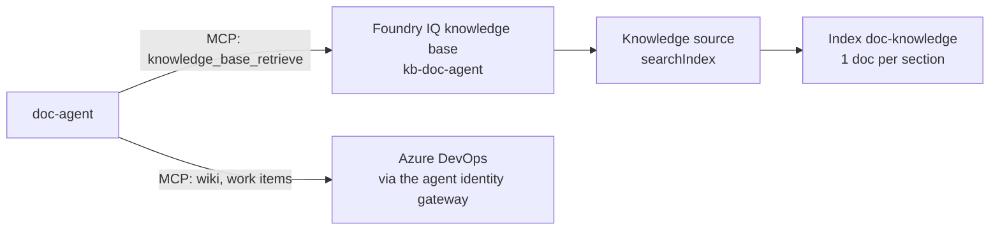

# Workshop guide: Foundry IQ knowledge for the Documentation Agent

**Feature:** F3 · **Owner:** P2 Rickard · **Issue:** [#19](https://github.com/wdhm/foundry-agentic-pattern/issues/19) · **Scope:** MVP ([ADR 0022](../adr/0022-mvp-scope-platform-first.md))

## The result

The agent grounds its gap analysis in the organisation's **documentation standard** ([`data/knowledge/documentation-standard.md`](../../data/knowledge/documentation-standard.md)). The standard lives in a **Foundry IQ knowledge base**, and the agent reaches it as an MCP tool. In one run the agent:

1. calls `knowledge/knowledge_base_retrieve` to get the standard;
2. calls `ado/wiki` and `ado/wit_work_item` to read the current page and work item live ([agent identity guide](agent-identity-guide.md));
3. returns findings that cite rule IDs, for example *"missing Data flow … Error handling sections, required by DS-11 through DS-17"*, with source references.



## Concepts in one minute

- **Foundry IQ** is the managed knowledge layer for agents, built on Azure AI Search ([What is Foundry IQ?](https://learn.microsoft.com/azure/foundry/agents/concepts/what-is-foundry-iq)).
- A **knowledge source** points at content: a search index, Blob Storage, SharePoint, OneLake or the web ([knowledge sources](https://learn.microsoft.com/azure/search/agentic-knowledge-source-overview)).
- A **knowledge base** groups knowledge sources and runs agentic retrieval over them ([create a knowledge base](https://learn.microsoft.com/azure/search/agentic-retrieval-how-to-create-knowledge-base)).
- Each knowledge base has an **MCP endpoint**. A Foundry agent calls it through a project connection that uses the **project's managed identity** ([connect to Foundry Agent Service](https://learn.microsoft.com/azure/foundry/agents/how-to/foundry-iq-connect)).

## Design choices (MVP)

| Choice | Why |
|---|---|
| **Stable knowledge in Foundry IQ, live data through tools** ([ADR 0011](../adr/0011-knowledge-foundry-iq-and-toolbox.md)) | The standard rarely changes, so it suits an index. The wiki and work items change all the time, so the agent reads them live through Azure DevOps MCP. An indexed copy would go stale. |
| **Search index knowledge source** ([how-to](https://learn.microsoft.com/azure/search/agentic-knowledge-source-how-to-search-index)) | Fewest moving parts: no storage account, indexer or embedding model. We upload one document per `##` section. |
| **Low retrieval reasoning effort with retrieval instructions** ([how-to](https://learn.microsoft.com/azure/search/agentic-retrieval-how-to-set-retrieval-reasoning-effort)) | The knowledge base plans its own subqueries with `gpt-5.4-mini`, shared with the evaluator (deployment `eval-gpt-5.4-mini`), following retrieval instructions that say what the source is for. Retrieval instructions require a model; `minimal` has none. Changed from `minimal` on 2026-10-23. |
| **Rule IDs instead of a new evidence type** | The standard is the rulebook, not evidence about the integration. Findings cite `DS-xx` rule IDs, and the agent's output schema stays unchanged. |

## Setup

One idempotent script runs all of it: [`infra/scripts/setup-foundry-iq.ps1`](../../infra/scripts/setup-foundry-iq.ps1).

```powershell
./infra/scripts/setup-foundry-iq.ps1 -ResourceGroup rg-foundry-agentic-pattern `
    -FoundryAccount <foundry-account> -Project <project> -SearchService <search-name> -AgentName doc-agent
```

| Step | What | Reference |
|---|---|---|
| 1 | Azure AI Search, **Basic** tier, system-assigned identity, Entra auth, free semantic ranker | [Create a search service](https://learn.microsoft.com/azure/search/search-create-service-portal) |
| 2 | Roles: you get **Search Service Contributor** and **Search Index Data Contributor**; the **project managed identity** gets **Search Index Data Reader**; the **search service identity** gets **Cognitive Services User** on the Foundry account for query planning | [Search RBAC](https://learn.microsoft.com/azure/search/search-security-rbac) |
| 3 | Index `doc-knowledge` with a default semantic configuration; upload `data/knowledge/*.md` | [Agentic retrieval index](https://learn.microsoft.com/azure/search/agentic-retrieval-how-to-create-index) |
| 4 | Knowledge source `ks-doc-knowledge` (`searchIndex`) and knowledge base `kb-doc-agent` (`low`, model `eval-gpt-5.4-mini`, retrieval instructions, `extractiveData`). Both descriptions say what is indexed, where it comes from and why | [Search index knowledge source](https://learn.microsoft.com/azure/search/agentic-knowledge-source-how-to-search-index) |
| 5 | Project connection `kb-doc-agent-mcp`: `RemoteTool`, `ProjectManagedIdentity`, audience `https://search.azure.com/` | [Create a project connection](https://learn.microsoft.com/azure/foundry/agents/how-to/foundry-iq-connect#create-a-project-connection) |
| 6 | New agent version: MCP tool `knowledge` with `allowed_tools: [knowledge_base_retrieve]` and `require_approval: never`, plus one line in the instructions | [Create an agent with the MCP tool](https://learn.microsoft.com/azure/foundry/agents/how-to/foundry-iq-connect#create-an-agent-with-the-mcp-tool) |

To swap in your own standard, replace the files in `data/knowledge/` and rerun the script.

## Demo (about 5 minutes)

1. Show the standard file and its rule IDs.
2. In the Foundry portal, open the agent's tools and show the `knowledge` and `ado` MCP tools.
3. In the playground, ask: *"Assess the wiki page /Order Sync/Overview against our documentation standard. Which required sections are missing?"*
4. Show the trace: `knowledge_base_retrieve` runs first, then the `ado` wiki and work item calls. Point out that findings cite `DS-xx`.

## Gotchas we hit

- **Region capacity.** Sweden Central returned `InsufficientResourcesAvailable` for a new search service, so ours runs in **France Central**. Check [region support for agentic retrieval](https://learn.microsoft.com/azure/search/search-region-support).
- **Storage public access is forced off by tenant policy.** The policy turned `publicNetworkAccess` to `Disabled` on new storage accounts. A **Blob knowledge source** would then need private endpoints and an S2 or higher search tier. A search index source avoids storage altogether.
- **API versions.** The knowledge base MCP endpoint needs `api-version=2026-08-01-preview`. Project connections use ARM `2025-10-01-preview`.
- **Strict output schema.** The agent's JSON schema allows only `git`, `wiki` and `work_item` as evidence sources. Cite the standard by rule ID instead of adding a source type.

## Production notes (slides)

- Use a Blob or SharePoint knowledge source with scheduled ingestion for many documents ([#48](https://github.com/wdhm/foundry-agentic-pattern/issues/48)).
- Turn on query planning (`low` or `medium` effort) and answer synthesis when questions span several sources.
- Use private networking and document-level permissions ([enforce permissions at query time](https://learn.microsoft.com/azure/search/agentic-retrieval-how-to-retrieve#enforce-permissions-at-query-time-preview)). See [next steps §9](../next-steps.md#9-production-hardening-out-of-mvp-scope).
