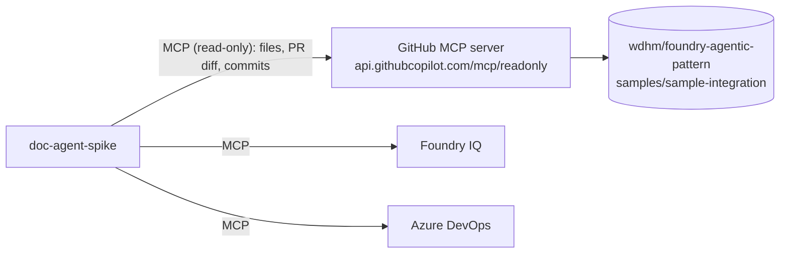

# Workshop guide: GitHub as a code source through MCP

**Feature:** F1 Toolbox · **Owner:** P2 Rickard · **Issue:** [#20](https://github.com/wdhm/foundry-agentic-pattern/issues/20) · **Scope:** MVP ([ADR 0022](../adr/0022-mvp-scope-platform-first.md))

## The result

The agent reads the integration code and the pull request diff from GitHub, compares them with the wiki and cites the **commit SHA** as the evidence version. Verified run against `doc-agent-spike:6` (2026-10-14), in the order the agent chose:

1. `knowledge/knowledge_base_retrieve`: the documentation standard ([Foundry IQ guide](foundry-iq-guide.md));
2. `github/pull_request_read` with `method: get` and then `method: get_diff`: PR #62 metadata, head SHA and diff;
3. `ado/wiki` (`get_page /Order Sync/Overview`) and `ado/wit_work_item` (#1): the current page and its work item ([agent identity guide](agent-identity-guide.md));
4. `github/get_file_contents` at the head SHA `ad62314…`.

Result (shortened): `documentation_status: gaps_found`. Finding: *"The PR diff changes retry behavior from 3 attempts with a fixed 5-second delay to 5 attempts with exponential backoff starting at 2 seconds. The current wiki page does not document retry behavior. It also does not document the new `erp.timeoutSeconds` setting (30) or the `source.deadLetterQueue` setting… DS-30."* Evidence `{id: G1, source: git, uri: …/pull/62, version: ad623147fbb1eeb9a6423d437df199c91db15a9e}`; `requires_human_review: true`.



## The demo data

| What | Where |
|---|---|
| Sample integration (order sync, webshop → Fabrikam ERP) | [`samples/sample-integration/`](../../samples/sample-integration/README.md) |
| Demo change: exponential retry, ERP timeout and dead-letter queue. Keep it open; don't merge | [PR #62](https://github.com/wdhm/foundry-agentic-pattern/pull/62) |
| The wiki page that has drifted | Azure DevOps wiki `/Order Sync/Overview` |

## Design choices (MVP)

| Choice | Why |
|---|---|
| **GitHub's hosted MCP server** instead of our own | Zero code to run. GitHub maintains the tools ([remote server docs](https://github.com/github/github-mcp-server/blob/main/docs/remote-server.md)). |
| **Read-only URL** `…/mcp/readonly` plus `allowed_tools` | Two layers: the server exposes only read tools, and Foundry lets the agent call just five of them. |
| **Key-based auth with a fine-grained token** in a project connection ([MCP authentication](https://learn.microsoft.com/azure/foundry/agents/how-to/mcp-authentication#key-based-authentication)) | GitHub doesn't accept Microsoft Entra tokens, so the agent identity used for Azure DevOps can't be used here. A fine-grained token can be limited to one repository and read-only access. |
| **No approval** on GitHub tools | They only read. Approval stays on the Azure DevOps wiki write. |

## Setup

One idempotent script: [`infra/scripts/setup-github-mcp.ps1`](../../infra/scripts/setup-github-mcp.ps1).

1. **Create a fine-grained token** ([GitHub docs](https://docs.github.com/authentication/keeping-your-account-and-data-secure/managing-your-personal-access-tokens#creating-a-fine-grained-personal-access-token)). This [prefilled link](https://github.com/settings/personal-access-tokens/new?name=foundry-doc-agent-github-mcp&description=Read-only+GitHub+MCP+access+for+the+Foundry+Documentation+Agent&expires_in=90&contents=read&pull_requests=read) sets the name, a 90-day expiry, and **Contents** and **Pull requests** to **Read-only** ([URL parameters](https://docs.github.com/authentication/keeping-your-account-and-data-secure/managing-your-personal-access-tokens#pre-filling-fine-grained-personal-access-token-details-using-url-parameters)). Choose **Only select repositories** → your fork yourself; the repository can't be prefilled.
2. **Run the script.** It prompts for the token without echoing it, or reads `$env:GITHUB_MCP_TOKEN`.

```powershell
./infra/scripts/setup-github-mcp.ps1 -ResourceGroup rg-foundry-agentic-pattern `
    -FoundryAccount <foundry-account> -Project <project> -AgentName doc-agent-spike
```

| Step | What | Reference |
|---|---|---|
| 1 | Project connection `github-mcp`: category `RemoteTool`, auth `CustomKeys`, key `Authorization` = `Bearer <token>`, target `https://api.githubcopilot.com/mcp/readonly` | [Configure a connection](https://learn.microsoft.com/azure/foundry/agents/how-to/tools/tool-authentication#configure-a-connection-for-each-authentication-type) |
| 2 | New agent version: MCP tool `github` with `allowed_tools` (`get_file_contents`, `get_commit`, `list_commits`, `pull_request_read`, `list_pull_requests`) and `require_approval: never`, plus one line in the instructions about citing the commit SHA | [Connect to MCP servers](https://learn.microsoft.com/azure/foundry/agents/how-to/tools/model-context-protocol) |

**Portal alternative:** Agent → Tools → Add → Catalog → GitHub. Foundry creates the same Custom keys connection.

## Demo (about 5 minutes)

1. Show PR #62: a small change to retry, timeout and the dead-letter queue.
2. Show the agent's tools in the Foundry portal: `github` (read-only), `knowledge` and `ado`.
3. In the playground, ask: *"Pull request 62 in wdhm/foundry-agentic-pattern changes Order Sync. Compare the change with the wiki page /Order Sync/Overview and our documentation standard. What is now missing or outdated?"*
4. Show the trace: the `github` calls, then `knowledge` and `ado`. Point out that the git evidence carries the PR head SHA.

## Gotchas

- **No Entra for GitHub.** Key-based auth means a token to rotate. Anyone with access to the project can read a key stored in a project connection, so keep it read-only and scoped to one repository.
- **The tool list changes.** GitHub merges tools: PR details, diff and files are all one tool, `pull_request_read`, with a `method` argument (`get`, `get_diff`, …). List the tools (MCP `tools/list`) before you set `allowed_tools`.
- **Demo PR base.** PR #62 must stay open. If you fork the repo, recreate it in your fork.

## Production notes (slides)

- Use a **GitHub App** installation token, or **OAuth identity passthrough** so each user's own GitHub permissions apply ([OAuth identity passthrough](https://learn.microsoft.com/azure/foundry/agents/how-to/mcp-authentication#oauth-identity-passthrough)).
- Bundle GitHub, Azure DevOps and Foundry IQ in one **Foundry Toolbox** with central authentication ([toolbox](https://learn.microsoft.com/azure/foundry/agents/how-to/tools/toolbox)).
- Use **Azure Repos** as the code source via the Azure DevOps MCP server ([#44](https://github.com/wdhm/foundry-agentic-pattern/issues/44)).
