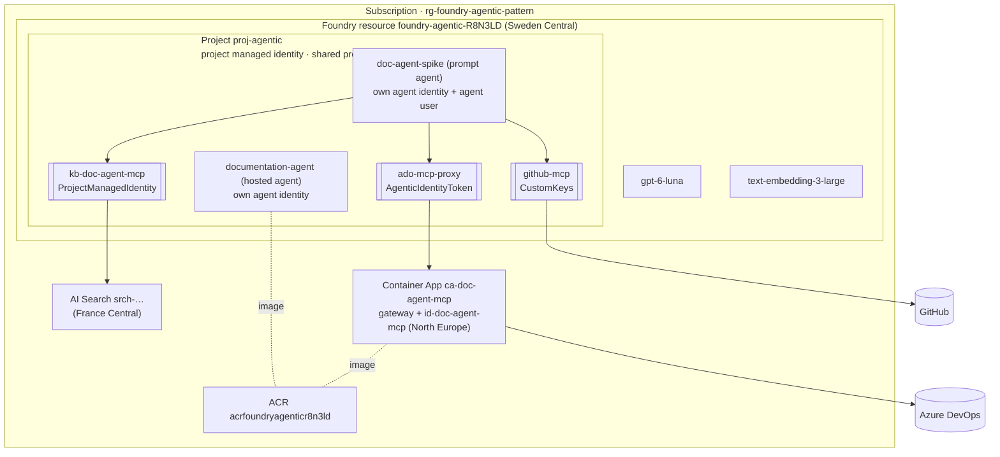

# Workshop guide: resource organisation (Foundry resource, project, connections, identities)

**Area:** Identities & resource organisation · **Owner:** P2 Rickard · **Issue:** [#45](https://github.com/wdhm/foundry-agentic-pattern/issues/45) · **Scope:** MVP ([ADR 0022](../adr/0022-mvp-scope-platform-first.md))

## The result

One Foundry resource with one project holds the agents, connections and model deployments. Each agent has its **own** Entra agent identity. Connected services (AI Search, the Azure DevOps gateway) are separate Azure resources with their own access control. Everything below was read from the live environment on 2026-10-14 and matches [setup.md](../setup.md).

## Levels and what lives where

| Level | What lives here | In our environment | Reference |
|---|---|---|---|
| **Foundry resource** (`Microsoft.CognitiveServices/accounts`, kind `AIServices`) | Governance: networking, security settings, **model deployments**, quota. Control-plane RBAC | `foundry-agentic-R8N3LD`, deployments `gpt-6-luna` and `text-embedding-3-large` | [Foundry architecture](https://learn.microsoft.com/azure/foundry/concepts/architecture#foundry-resource-hierarchy) |
| **Project** (child resource) | Development isolation: **agents, connections**, evaluations, files. Data-plane RBAC can be scoped here | `proj-agentic` (default project) | [Create multiple projects on one resource](https://learn.microsoft.com/azure/foundry/how-to/create-projects#create-multiple-projects-on-the-same-resource) |
| **Agent** (+ versions) | Instructions, model, tools. Each new version keeps the agent's identity | `doc-agent-spike` (v6), `documentation-agent` (hosted, v2) | [Agent identity concepts](https://learn.microsoft.com/azure/foundry/agents/concepts/agent-identity) |
| **Connected resources** | Separate Azure resources with their own governance and RBAC | AI Search, Container App gateway, ACR. Application Insights is connected to the project when tracing lands ([#5](https://github.com/wdhm/foundry-agentic-pattern/issues/5)) | [Foundry architecture](https://learn.microsoft.com/azure/foundry/concepts/architecture#foundry-resource-hierarchy) |

Region is per resource. Capacity pushed us into **three regions**: Foundry in Sweden Central, AI Search in France Central, Container Apps in North Europe. That works because the agent reaches them through connections over HTTPS.

## Identities: who authenticates where

| Principal | Entra display name | Used for | Access it has |
|---|---|---|---|
| Account managed identity | `foundry-agentic-R8N3LD` | Resource-level access to other Azure services | None assigned; not needed in the MVP |
| **Project managed identity** | `foundry-agentic-R8N3LD/projects/proj-agentic` | Connections with auth `ProjectManagedIdentity`; also federates the shared agent identity blueprint | **Search Index Data Reader** on AI Search (Foundry IQ) |
| Shared project agent identity | in the project's JSON view (`agentIdentity`) | Default identity for in-development agents in the agent application model | None; our agents use their own identity |
| **Agent identity: `doc-agent-spike`** | `foundry-agentic-R8N3LD-proj-agentic-doc-agent-spike-AgentIdentity` | Connection `ado-mcp-proxy` (`AgenticIdentityToken`) | App role `Mcp.Tools.ReadWrite.All` on the gateway app; linked **agent user** for Azure DevOps ([agent identity guide](agent-identity-guide.md)) |
| Agent identity: `documentation-agent` | `foundry-agentic-R8N3LD-proj-agentic-documentation-agent-AgentIdentity` | Hosted agent runtime | None yet (stub) |
| User-assigned MI `id-doc-agent-mcp` | `id-doc-agent-mcp` | Gateway: federated credential on the agent's blueprint for the agent-user token exchange | **AcrPull** on the ACR |

Key point for the workshop: **the connection decides which identity is presented**. The same agent uses three identities across its three tools:

| Connection | Auth type | Identity presented | Why |
|---|---|---|---|
| `ado-mcp-proxy` | `AgenticIdentityToken` | The **agent's** identity (then the agent user, via the gateway) | Wiki edits must be attributable to the agent, not a person |
| `kb-doc-agent-mcp` | `ProjectManagedIdentity` | The **project's** managed identity | Read-only shared knowledge; one role assignment serves every agent in the project |
| `github-mcp` | `CustomKeys` | A fine-grained **token** | GitHub doesn't accept Entra tokens ([GitHub MCP guide](github-mcp-guide.md)) |

References: [MCP tool authentication](https://learn.microsoft.com/azure/foundry/agents/how-to/mcp-authentication), [RBAC for Foundry](https://learn.microsoft.com/azure/foundry/concepts/rbac-foundry), [agent types during the transition](https://learn.microsoft.com/azure/foundry/agents/how-to/migrate-agent-applications#agent-types-during-the-transition).

## Naming

| Thing | Pattern | Example |
|---|---|---|
| Foundry resource | `foundry-<workload>-<suffix>` | `foundry-agentic-R8N3LD` |
| Project | `proj-<workload>` | `proj-agentic` |
| Agent | `<role>-agent` | `documentation-agent` (`doc-agent-spike` for the MVP prompt agent) |
| Agent identity | set by Foundry: `<resource>-<project>-<agent>-AgentIdentity` | see above |
| Connection | `<source>-mcp[-proxy]` | `github-mcp`, `kb-doc-agent-mcp` |
| Other Azure resources | [CAF abbreviations](https://learn.microsoft.com/azure/cloud-adoption-framework/ready/azure-best-practices/resource-abbreviations) + workload | `srch-…`, `ca-…`, `id-…`, `acr…` |

## How this scales to many agents

| Need | Do this | Reference |
|---|---|---|
| Another agent in the same use case | Same project; it gets its own agent identity. Re-run [`onboard-agent.ps1`](../../infra/scripts/onboard-agent.ps1) for Azure DevOps access. Project-MI connections (Foundry IQ) work without new role assignments | [agent identity guide](agent-identity-guide.md#onboard-another-agent-automated) |
| Another team or use case | **New project** on the same Foundry resource: shares deployments and network settings, isolates agents, connections and access | [Rollout: topology](https://learn.microsoft.com/azure/foundry/concepts/planning#choose-foundry-resource-topology) |
| Strict production isolation, own quota or cost boundary | **Separate Foundry resource** per workload boundary | [Rollout: topology](https://learn.microsoft.com/azure/foundry/concepts/planning#choose-foundry-resource-topology) |
| Cost per team | Project-level cost attribution | [Chargeback per project](https://learn.microsoft.com/azure/foundry/concepts/manage-costs#chargeback-with-project-level-cost-attribution-preview) |
| See all agents | Foundry fleet management ([#42](https://github.com/wdhm/foundry-agentic-pattern/issues/42)); Agent 365 across M365 ([#46](https://github.com/wdhm/foundry-agentic-pattern/issues/46), slides) | |

## Demo (about 3 minutes)

1. Azure portal → resource group: the Foundry resource, the project as a child, and the connected resources in other regions.
2. Foundry portal → project → **Connected resources**: the three connections and their auth types.
3. Entra admin center → **Agent ID**: `doc-agent-spike`'s agent identity and its agent user. Point out: one identity per agent, the wiki history shows the agent as author.
4. Show the table *the connection decides which identity is presented*.

## Gotchas

- **Learn describes two identity models.** The agent identity article describes a *shared* project identity for unpublished agents (agent application model). In the newer agent model we use, every agent gets its own identity on creation, and versions keep it; we verified this across versions. The shared project identity still exists in the project's JSON view.
- **Project MI vs agent identity.** A connection with `ProjectManagedIdentity` means every agent in the project shares that access. Use `AgenticIdentityToken` when actions must be attributable per agent.
- **Connected resources are separate.** Their RBAC, network and region are managed on that resource, not in Foundry.

## Production notes (slides)

- Least privilege per identity and a full RBAC matrix ([#22](https://github.com/wdhm/foundry-agentic-pattern/issues/22), [architecture §6](../architecture.md#6-identity--rbac-matrix)).
- Landing zone and subscription vending per workload ([#50](https://github.com/wdhm/foundry-agentic-pattern/issues/50)).
- Codify the hierarchy as `azd` + Bicep ([#52](https://github.com/wdhm/foundry-agentic-pattern/issues/52)).
