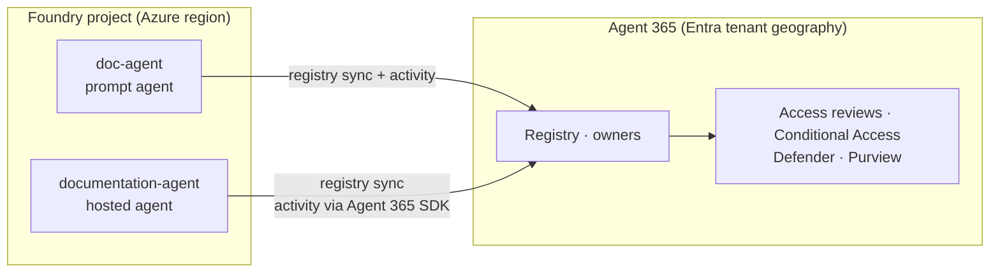

# Slides: Agent 365 (P2, [#46](https://github.com/wdhm/foundry-agentic-pattern/issues/46))

Slot: 11:03–11:10 in the [agenda](../agenda.md), after the Foundry IQ and identity demos. This topic is slides only ([ADR 0014](../../adr/0014-infrastructure-scope.md)).

---

## Slide 1: One control plane for every agent

**Microsoft Agent 365** is the tenant-wide control plane for AI agents. Agents become first-class **Microsoft Entra** identities (Entra Agent ID).

| Pillar | What you get |
|---|---|
| Registry | Inventory of every agent (Foundry, Copilot Studio, admin-registered, shadow agents) with owners |
| Access control | Entra RBAC/ABAC and risk-based Conditional Access on the agent identity |
| Visualization | Connections between agents, people and data; live behaviour |
| Interoperability | Microsoft 365 apps and Work IQ context |
| Security | Defender threat detection, Purview data protection |

**How Foundry connects**
- **Registry sync:** every *published* Foundry agent shows up in the Agent 365 registry automatically.
- **Autopilots:** a *hosted* agent with its own Entra agent user can be hired from Teams and other Microsoft 365 surfaces.

> **Speaker notes:** Foundry fleet management ([#42](https://github.com/wdhm/foundry-agentic-pattern/issues/42)) answers "what runs in my Foundry projects?" for builders. Agent 365 answers "what agents exist in my tenant, who owns them, and what can they touch?" for IT and security. They complement each other. Admins block, reassign, or delete agents from the Microsoft 365 admin center.

---

## Slide 2: What it means for the Documentation Agent

| Already in the repo | Agent 365 adds |
|---|---|
| Entra agent identity per agent, with least privilege on Azure DevOps and Search ([identity guide](../agent-identity-guide.md)) | Tenant-wide inventory, owner attestation, access reviews, and lifecycle policies on that identity |
| Foundry tracing and evaluations | Usage and risk dashboards next to every other agent in the tenant |

**Before you turn it on**
- Prompt agents get registry sync and activity data. Only hosted agents can be published as autopilots.
- The tenant needs at least one Microsoft 365 Copilot licence, Frontier programme enrolment, and a global admin who enables Agent 365.
- Data moves from Azure-region residency (Foundry) to Entra-tenant residency (Agent 365). You can opt out per Foundry resource.

> **Speaker notes:** We built identity first, so the Documentation Agent is ready to be governed: it already has its own Entra identity with scoped rights. Agent 365 does not change how the agent runs. It changes who can see it, review it and switch it off. Mention residency for regulated customers.

---

## References

- [Microsoft Agent 365 integration with Foundry](https://learn.microsoft.com/azure/foundry/agents/concepts/agent-365-integration)
- [Overview of Microsoft Agent 365](https://learn.microsoft.com/microsoft-agent-365/overview)
- [Agent Registry convergence with Agent 365](https://learn.microsoft.com/entra/agent-id/agent-registry-convergence)
- [Governance and lifecycle actions in the Microsoft 365 admin center](https://learn.microsoft.com/microsoft-365/admin/manage/agent-actions)
- [Configure Agent 365 data collection for Foundry](https://learn.microsoft.com/azure/foundry/agents/how-to/configure-agent-365-data-collection)
