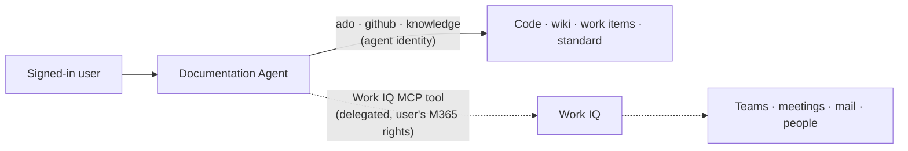

# Slides: Work IQ (P2, [#47](https://github.com/wdhm/foundry-agentic-pattern/issues/47))

Slot: 11:03–11:10 in the [agenda](../agenda.md). This topic is slides only ([ADR 0014](../../adr/0014-infrastructure-scope.md)).

---

## Slide: Work context for the agent

**Work IQ** is the Microsoft 365 intelligence layer: mail, meetings, files, people, chats and sites. It respects existing permissions. You reach it through **MCP, A2A or REST**.

**Where it would help the Documentation Agent**
- Find the **right reviewer**: who owns or last discussed `order-sync`?
- Pull in **related discussions**: the Teams thread or meeting notes about the change.
- Fill **missing information** ([#32 guide](../information-missing-guide.md)) with a pointer to a person, never an invented value.

**How it plugs in**
- In Foundry, add **Work IQ MCP** from the tool catalogue (`https://workiq.svc.cloud.microsoft/mcp`), or a Work IQ knowledge source in Foundry IQ (preview).
- A one-time tenant setup is needed: an Entra app with delegated `WorkIQAgent.Ask` permission and admin consent.

**Trade-offs**
- It runs **on behalf of the signed-in user**, not the agent identity. That suits interactive use. It doesn't suit CI-triggered runs (see [next steps §6](../../next-steps.md#6-on-behalf-of-obo-identity)).
- **Scope and consent** matter. Allow only the tools you need, and keep approval on for actions.
- M365 content is **not versioned evidence**. Use it for context and people, not as cited proof of what the system does.

> **Speaker notes:** Our MVP grounds on engineering sources with the agent's own identity. Work IQ adds the human side, such as who to ask and what was discussed. The identity model is the key point: Work IQ is delegated, so the answer depends on who asks. Some connectors need a Microsoft 365 Copilot licence per user.

---

## References

- [Work IQ overview](https://learn.microsoft.com/microsoft-365/copilot/extensibility/work-iq/)
- [Work IQ API overview](https://learn.microsoft.com/microsoft-365/copilot/extensibility/work-iq/api-overview)
- [Work IQ MCP overview](https://learn.microsoft.com/microsoft-365/copilot/extensibility/work-iq/mcp/overview)
- [Connect agents to Microsoft 365 with Work IQ (Foundry)](https://learn.microsoft.com/azure/foundry/agents/how-to/tools/work-iq)
- [Connect a Foundry project to Work IQ (quickstart)](https://learn.microsoft.com/microsoft-365/copilot/extensibility/work-iq/mcp/quickstart/foundry)
- [Work IQ knowledge source (preview)](https://learn.microsoft.com/azure/search/agentic-knowledge-source-how-to-work-iq)
